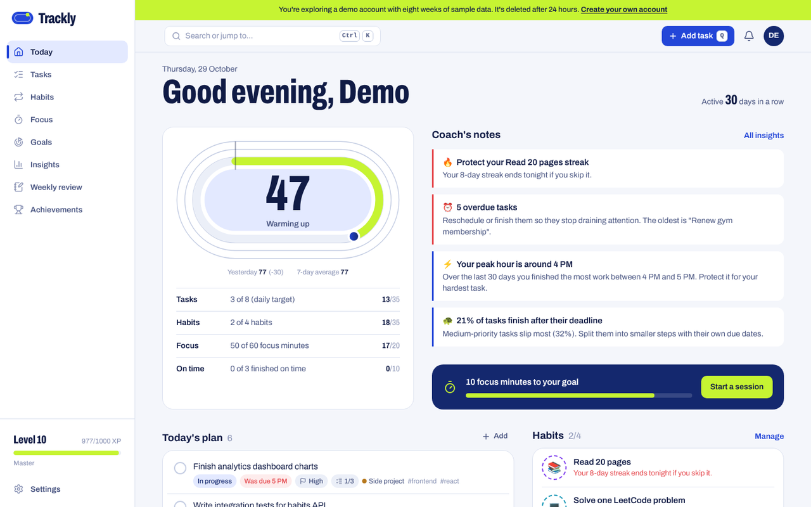
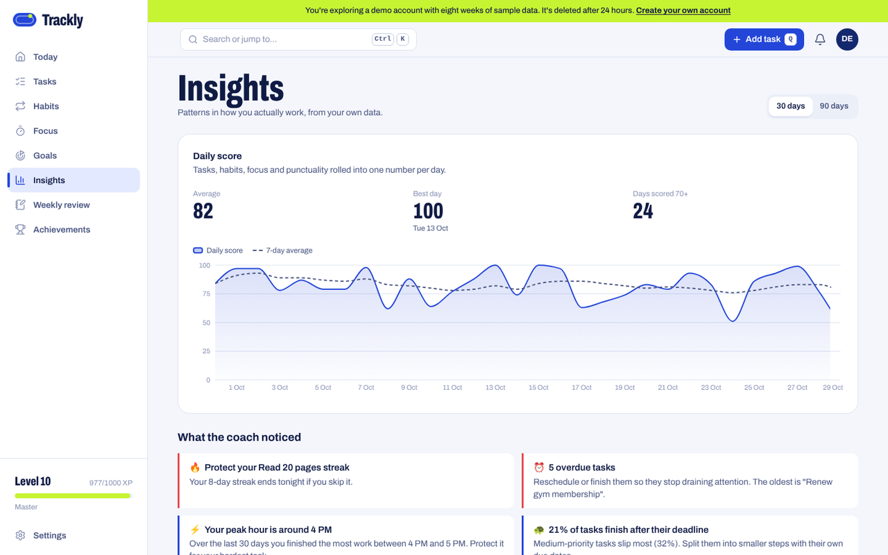
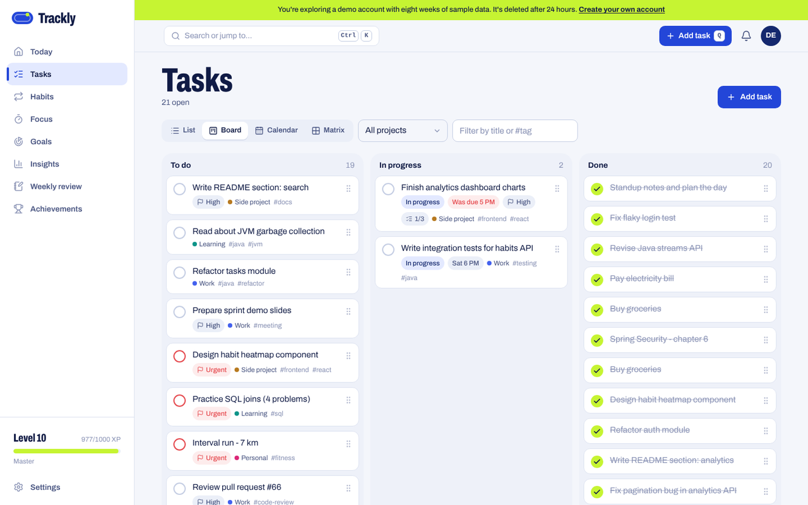
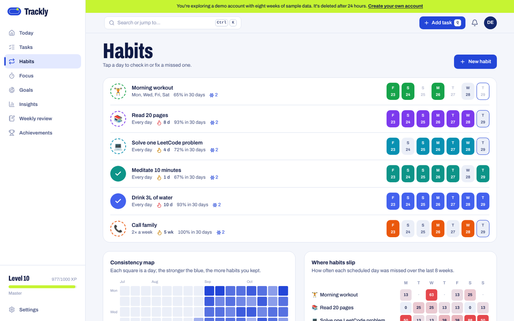
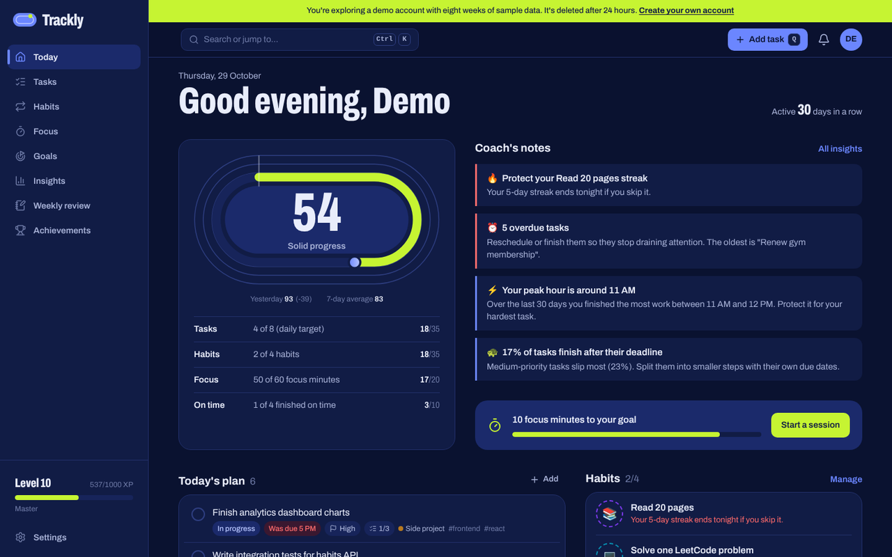
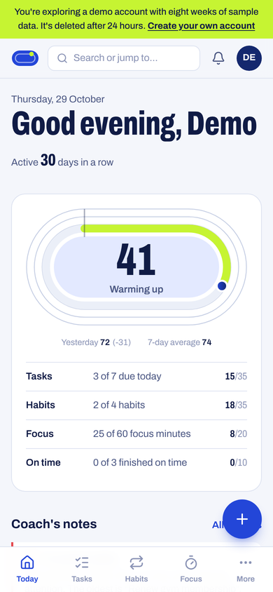
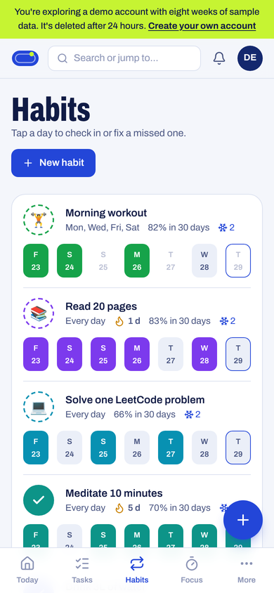
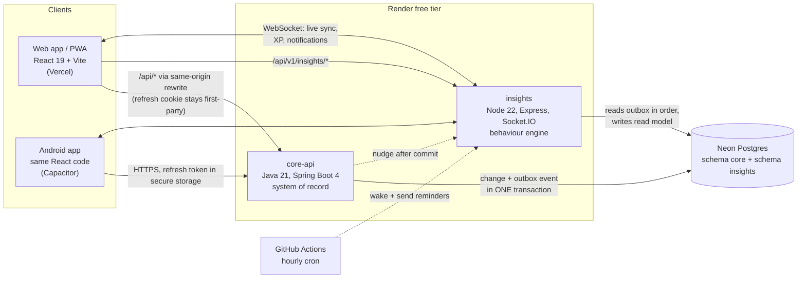

# Trackly

**A behaviour-based productivity system.** Tasks, habits and focus sessions in one place, plus a
coach that reads your own data and tells you when you work best, which habit you're about to drop,
and what to fix next week.

[](https://github.com/Hanumanth-Raghavendra/trackly/actions/workflows/ci.yml)
[](https://github.com/Hanumanth-Raghavendra/trackly/actions/workflows/android.yml)
[](LICENSE)



Runs entirely on free plans: Vercel, Render, Neon and GitHub Actions, with no credit card anywhere.
The same React code ships as a web app, an installable PWA and an Android app.

## What it does

| | |
|---|---|
| **Today** | One explainable score per day, drawn as a running track with three lanes (tasks, habits, focus). Every point traces back to something you did. |
| **Tasks** | List, board (drag and drop), calendar and Eisenhower-matrix views over the same tasks. Subtasks, tags, projects, goals and repeating tasks. Quick add understands `Send invoice fri 5pm #work !high`. |
| **Habits** | Daily, specific weekdays, or X times a week. Streaks, streak freezes, mood check-ins and a year-long heatmap. |
| **Focus** | A Pomodoro timer linked to a task. It survives reloads and background tabs, and works offline. |
| **Insights** | Score trend, a peak-hours heatmap, a procrastination index (how much of the time before a deadline you use), habit patterns by weekday, and coach cards like *"You usually skip Morning workout on Wednesdays (70%)"*. |
| **Weekly review** | Wins, slips and one concrete change for next week. It compares a running week fairly with the same days of last week. Optional AI summary. |
| **Goals and levels** | Goals fill up from linked tasks and habits. XP, levels and 17 achievements. |
| **Everywhere** | Live sync across tabs and devices, notification centre, command palette (`Ctrl K`), keyboard shortcuts, offline quick-capture, web push, an Android app with on-device habit reminders, and a one-click demo with 8 weeks of realistic history. |

<table>
  <tr>
    <td></td>
    <td></td>
  </tr>
  <tr>
    <td></td>
    <td></td>
  </tr>
</table>
<p>
  
  
</p>

## Architecture



- **core-api** owns the data: auth, tasks, habits, goals, focus sessions. Every change also writes
  an event to a **transactional outbox** in the same database transaction.
- **insights** consumes those events in order, idempotently, into its own read model (CQRS).
  It computes scores, patterns, XP and achievements, then pushes live updates over WebSockets.
- No message broker to run: the outbox table **is** the queue, with exactly-once effects, dead
  letters and replay. See [docs/EVENTS.md](docs/EVENTS.md).

## Tech stack

| Layer | Stack |
|---|---|
| Web | React 19, TypeScript, Vite 8, Tailwind CSS 4, TanStack Query, React Router, Radix UI, Recharts, dnd-kit, chrono-node, Socket.IO client, Workbox PWA |
| Mobile | Capacitor 8 (Android): Preferences, Local Notifications, Haptics |
| core-api | Java 21 (virtual threads), Spring Boot 4.1, Spring Security, Spring Data JPA + JdbcTemplate, Flyway, Nimbus JOSE JWT, springdoc OpenAPI |
| insights | Node 22, TypeScript, Express 5, Socket.IO, node-postgres, Zod, jose, web-push, pino |
| Data | PostgreSQL 16+ (Neon in production) |
| Quality | JUnit 5 + MockMvc against real Postgres, Vitest, Testing Library, Playwright (desktop + mobile), ESLint, strict TypeScript |
| Delivery | Docker (CDS-tuned JVM image), docker compose, GitHub Actions, Render Blueprint, Vercel |

## Engineering highlights

- **Transactional outbox + idempotent consumer.** Advisory-lock leader election, per-event
  savepoints, a dead-letter table, offset and projections committed together, side effects only
  after commit.
- **Auth done properly.** Short-lived JWTs, rotating refresh tokens stored hashed, theft detection
  by token-family reuse, a grace window for lost responses, an httpOnly `SameSite=Strict` cookie
  on web and secure storage on Android, rate-limited auth endpoints.
- **Explainable scoring.** The daily score is a weighted, re-normalised sum, and the UI shows every
  component ("4 of 5 habits = 28 of 35 points").
- **Timezone-correct everywhere.** Days, streaks and reminders are computed in each user's own
  zone, including legacy names browsers still send (`Asia/Calcutta`) and windows across midnight.
- **Free-tier engineering.** CDS-optimised JVM start-up, a landing page that wakes the sleeping
  services while you read, adaptive polling that lets the database scale to zero, and an hourly
  GitHub Actions cron for reminders.
- **One codebase, three targets.** Web, installable PWA and Android, with a different auth
  transport for native (refresh token in the body) behind the same API.
- **Pluggable AI.** Rule-based by default (free), with Gemini, any OpenAI-compatible API or Claude
  switched on by configuration alone.

## Run it locally

**With Docker (one command):**

```bash
docker compose up --build
```

Web: <http://localhost:3000>. API docs: <http://localhost:8080/swagger-ui.html>.

**Without Docker** (Java 21, Maven, Node 22 and a local Postgres), see
[docs/DEVELOPMENT.md](docs/DEVELOPMENT.md), including Windows PowerShell commands.

## Tests

| Suite | What | Count |
|---|---|---|
| core-api | JUnit 5 unit tests + MockMvc integration tests against real Postgres | 50 |
| insights | Vitest unit tests + integration tests against real Postgres | 65 |
| web | Vitest + Testing Library (quick-add parser, dates) | 8 |
| end-to-end | Playwright on the full stack, desktop and mobile viewports | 3 journeys × 2 devices |

All of them run in GitHub Actions on every push, together with Docker builds of all three images.
Render only deploys a commit after CI is green.

## Deploy your own (free)

Step by step in [docs/DEPLOY.md](docs/DEPLOY.md): Vercel, Neon and Render with no credit card,
plus optional push notifications, an AI provider and an hourly reminder cron.

## Project layout

```
apps/web/            React web app, PWA and Capacitor Android project (apps/web/android)
services/core-api/   Spring Boot service: auth, tasks, habits, goals, focus, outbox
services/insights/   Node service: outbox consumer, analytics, coach, realtime, reminders, AI
docs/                Deploy, development, mobile, event contract, interview guide
scripts/             Icon generator, local stack script
render.yaml          Render Blueprint (both backends)
docker-compose.yml   The whole stack locally
```

## Docs

- [DEPLOY.md](docs/DEPLOY.md): free deployment, step by step
- [DEVELOPMENT.md](docs/DEVELOPMENT.md): local setup and tests
- [MOBILE.md](docs/MOBILE.md): the Android app and publishing to Google Play
- [EVENTS.md](docs/EVENTS.md): the event contract between the services
- [INTERVIEW.md](docs/INTERVIEW.md): how it works, design decisions and likely questions

## License

[MIT](LICENSE) © 2026 Hanumanth Raghavendra
